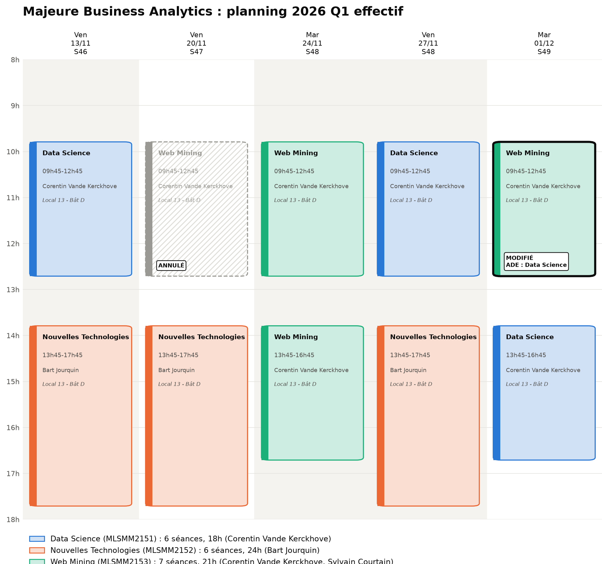
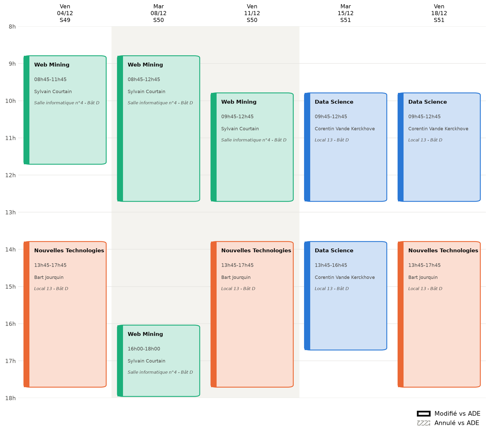

# MLSMM2151 : Data Science

> **Applied Data Science with Python** · Louvain School of Management, UCLouvain

Cours d'introduction à la Data Science appliquée avec Python, structuré autour
d'un **projet fil rouge** unique. C'est la suite naturelle du cours
[Data Analytics (MLSMM2116)](https://uclouvain.be/cours-2026-MLSMM2116), en version appliquée : la théorie y a été posée,
ici on la met en pratique, en code, sur des données réelles. Six séances de trois heures, entièrement
pratiques : le matériel est constitué de notebooks que vous ouvrez en un clic
dans Google Colab, et trois devoirs se rendent via GitHub.

Enseignant : Corentin Vande Kerckhove · `corentin.vandekerckhove[at]uclouvain.be`

---

## 🎯 Objectifs

À l'issue de ce cours, vous serez capable de :

- maîtriser l'écosystème Python du Data Scientist (Pandas, Matplotlib,
  Scikit-Learn) ;
- préparer, nettoyer et transformer des **données réelles**, avec tout ce
  qu'elles ont de désordonné ;
- construire, évaluer et comparer des modèles d'apprentissage supervisé et non
  supervisé ;
- **choisir et défendre** une méthodologie, plutôt que d'appliquer une recette ;
- interpréter des résultats de manière critique, et en reconnaître les limites ;
- appliquer les bonnes pratiques de reproductibilité d'un projet de data science.

---

## 📚 Table des matières

- [Calendrier](#-calendrier) : le planning de la majeure, et toutes les dates de ce cours
- [Organisation du dépôt](#-organisation-du-dépôt) : où trouver quoi
- [Prérequis](#-prérequis) : ce qu'il faut avant la première séance
- [Les données](#-les-données) : le fil rouge, et pourquoi rien n'est stocké ici
- [Évaluation](#-évaluation) : devoirs et examen
- [Notes collectives](#-notes-collectives) : les pads de prise de notes, et votre dossier `students/`
- [Utilisation des IA](#-utilisation-des-ia) : ce qui est permis, et à quelles conditions
- [Licence](#-licence)

Le plan détaillé du cours, section par section, est dans [`plan.md`](plan.md).

---

## 🗂️ Organisation du dépôt

Deux notions différentes, à ne pas confondre :

- les **chapitres** structurent la matière. Un chapitre = un dossier dans
  [`chapitres/`](chapitres/) = une unité de contenu cohérente ;
- les **séances** structurent le temps. Une séance = trois heures = un ou
  plusieurs chapitres.

Le calendrier ci-dessous fait le lien entre les deux. Si vous cherchez un sujet,
passez par les chapitres. Si vous cherchez ce qu'on fait mardi, passez par le
calendrier.

```
mlsmm2151/
├── chapitres/          La matière. Un dossier par chapitre, avec ses notebooks
│   └── chNN-.../
│       ├── README.md   Objectifs, séance de rattachement, durée, liens Colab
│       ├── 01-....ipynb
│       └── corriges/   Corrigés des hack-times, publiés après la séance
├── devoirs/            Énoncés, grilles de correction, squelettes des dépôts de devoir
├── data/               Codebooks et provenance. AUCUNE donnée, voir plus bas
├── examen/             Format de l'examen et matière concernée
├── students/           Votre espace : notes collectives, exercices, à vous de l'organiser
├── utils/              Code partagé, dont le chargement des données
├── plan.md             Le plan détaillé, chapitre par chapitre
├── CONTRIBUTING.md     Comment publier dans students/
├── requirements.txt
└── README.md
```

---

## 📅 Calendrier

### Calendrier général de la majeure

Ce cours est l'un des trois de la majeure Business Analytics. Voici le planning
effectif du quadrimestre, avec les deux autres cours, en deux moitiés
([version complète](images/planning-majeure-2026-q1.png)).

**Du 13 novembre au 1er décembre**



**Du 4 au 18 décembre**



### Calendrier spécifique de ce cours

Chaque séance compte 150 minutes de notebooks ; les 30 minutes restantes vont à
l'ouverture, à la pause et à la clôture. La séance 1 en compte 105 : le reste
va à l'inscription et à la mise en route de Colab et de GitHub. Les séances sont interactives : chaque
notebook alterne explication, démonstration et **hack-time**, cinq à dix
minutes pour modifier du code et regarder ce qui change. Venez avec un
ordinateur.

| Date | Quoi |
|---|---|
| ven 13/11, 9h45 | **Séance 1** : [Ch1 Le projet fil rouge](chapitres/ch01-projet-fil-rouge/) · [Ch2 Reproductibilité et Git](chapitres/ch02-reproductibilite-git/) |
| ven 27/11, 9h45 | **Séance 2** : [Ch3 Exploration et nettoyage](chapitres/ch03-exploration-nettoyage/) · [Ch4 Transformation des variables](chapitres/ch04-transformation-variables/) |
| ven 27/11, en séance | **Lancement du devoir** : D1 Préparation des données, démarré en fin de séance *(bientôt disponible, le 27/11)* |
| mar 01/12, 13h45 | **Séance 3** : [Ch5 Fondements du supervisé](chapitres/ch05-fondements-supervise/) · [Ch6 Modèles linéaires et arbres](chapitres/ch06-lineaires-arbres/) |
| mar 01/12, 13h45 | **Lancement du devoir** : D2 Modélisation supervisée *(bientôt disponible, le 01/12)* |
| dim 13/12, 23h59 | **Remise du devoir** : D1 Préparation des données *(bientôt disponible, le 27/11)* |
| mar 15/12, 9h45 | **Séance 4** : [Ch7 Évaluation des modèles](chapitres/ch07-evaluation-modeles/) · [Ch8 Validation et sélection](chapitres/ch08-validation-selection/) |
| mar 15/12, 13h45 | **Séance 5** : [Ch9 Ensemble learning](chapitres/ch09-ensemble-learning/) · [Ch10 Modèles avancés](chapitres/ch10-modeles-avances/) |
| ven 18/12, 9h45 | **Séance 6** : [Ch11 Clustering](chapitres/ch11-clustering/) · [Ch12 Réduction de dimension](chapitres/ch12-reduction-dimension/), et synthèse du cours |
| ven 18/12, 9h45 | **Lancement du devoir** : D3 Apprentissage non supervisé *(bientôt disponible, le 18/12)* |
| lun 04/01, 23h59 | **Remise du devoir** : D2 Modélisation supervisée *(bientôt disponible, le 01/12)* |
| dim 10/01, 23h59 | **Remise du devoir** : D3 Apprentissage non supervisé *(bientôt disponible, le 18/12)* |
| *date à venir* | **Examen** : voir [`examen/`](examen/) |

Le README de chaque chapitre donne ses objectifs, sa durée et les liens Colab de
ses notebooks. Le plan détaillé, section par section, est dans
[`plan.md`](plan.md).

---

## 🛠️ Prérequis

- **Le cours [Data Analytics (MLSMM2116)](https://uclouvain.be/cours-2026-MLSMM2116)**, ou l'équivalent.
- **Des bases en Python.** Variables, listes, boucles, fonctions.
- **Un compte Google**, pour utiliser Colab. Rien à installer sur votre machine.
- **Un compte GitHub**, pour rendre les devoirs. Créez-le avant la séance 1 :
  [github.com/signup](https://github.com/signup).

**Avant la séance 1, suivez le guide [`premiers-pas.md`](premiers-pas.md).** Il
contient tout : la création du compte GitHub, le formulaire d'inscription qui
relie votre pseudo à votre nom, les invitations à accepter, l'autorisation de
Colab et votre premier commit, avec une table de dépannage.

---

## 💾 Les données

**Aucune donnée n'est stockée dans ce dépôt, et c'est volontaire.** Les notebooks
téléchargent ce dont ils ont besoin. Votre travail personnel va dans votre Google
Drive ou votre OneDrive UCLouvain, jamais dans un dépôt git.

C'est une habitude professionnelle que le cours enseigne, pratique, et évalue
dans les devoirs. Le pourquoi et le comment sont dans
[`data/README.md`](data/README.md), et le chapitre 2 vous les fait appliquer.

Le fil rouge est un jeu de données **Airbnb Bruxelles** (Inside Airbnb,
CC BY 4.0), utilisé du premier au dernier chapitre, avec deux questions métier :
prédire le prix d'une annonce (régression) et repérer les profils Superhost
(classification).

---

## ✅ Évaluation

| Part | Quoi |
|---|---|
| **50 %** | Trois devoirs de programmation, rendus dans un dépôt GitHub privé |
| **50 %** | Examen en session : QCM et questions ouvertes |

Les devoirs :

| Devoir | Matière | Publié | Dû | Poids |
|---|---|---|---|---|
| D1 Préparation des données *(bientôt disponible, le 27/11)* | Ch1 à Ch4 | 27/11 | **13/12** | 15 % |
| D2 Modélisation supervisée *(bientôt disponible, le 01/12)* | Ch5 à Ch10 | 01/12 | **04/01** | 25 % |
| D3 Apprentissage non supervisé *(bientôt disponible, le 18/12)* | Ch11 et Ch12 | 18/12 | **10/01** | 10 % |

Les devoirs ne sont pas évalués sur le seul fait que le code tourne. La qualité
des choix méthodologiques, la clarté des explications, la reproductibilité et la
réflexion critique comptent autant. Les règles communes, les grilles de
correction et les garde-fous sur l'usage de l'IA sont dans
[`devoirs/README.md`](devoirs/README.md).

Le format de l'examen et la matière concernée sont dans
[`examen/README.md`](examen/README.md).

---

## 📝 Notes collectives

Chaque séance a son pad de prise de notes partagée, sur
[Framapad](https://framapad.org). Un étudiant est responsable du pad de la
séance : il le crée, en communique le lien aux autres, puis le restructure après
la séance et le publie dans [`students/`](students/) via une pull request,
relue par un autre étudiant. Tout le monde peut compléter : liens évoqués,
questions posées, commandes utiles, points restés obscurs.

Le dossier `students/` est le seul que vous pouvez modifier dans ce dépôt, et
vous l'organisez comme vous voulez : notes, exercices, scripts à partager. Le
fonctionnement est décrit dans [`CONTRIBUTING.md`](CONTRIBUTING.md).

Il n'y a pas de groupe de discussion pour ce cours. Les questions se posent en
séance, où la réponse profite à tous, ou par e-mail à l'enseignant.

---

## 🤖 Utilisation des IA

Certaines parties de ce matériel pédagogique ont été rédigées avec l'assistance
d'outils d'intelligence artificielle, selon un guide de style et de contenu
fixé par l'enseignant. L'ensemble des programmes, des explications et des
exercices reste sous sa responsabilité : il a validé chaque étape et vérifié que
chaque notebook s'exécute.

Votre propre usage de ces outils dans les devoirs est encadré, pas interdit :
les règles sont dans [`devoirs/README.md`](devoirs/README.md). La règle
principale est la transparence, et le fait que vous devez pouvoir expliquer et
défendre tout ce que vous rendez.

---

## 📄 Licence

Le contenu de ce dépôt est publié sous licence
[CC BY-NC-SA 4.0](LICENSE) : vous pouvez le réutiliser et l'adapter, à condition
de citer la source, sans usage commercial, et en partageant dans les mêmes
conditions.

Les données Airbnb proviennent d'[Inside Airbnb](https://insideairbnb.com) et
sont sous licence CC BY 4.0.
