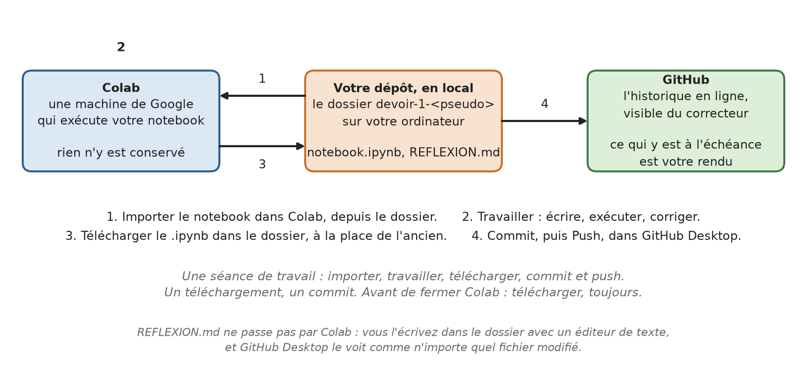

# Tutoriel : préparer le devoir 1 avec Colab et GitHub Desktop

*MLSMM2151 Data Science · Devoir 1, étape 1 · Séance 2, vendredi 27 novembre, après le notebook 2 du chapitre 2 · 45 minutes*

Ce tutoriel installe, une fois pour toutes, la façon dont vous travaillerez
sur les trois devoirs : **Colab exécute votre notebook, GitHub Desktop
l'enregistre dans votre dépôt**. À la fin, votre dépôt de devoir contient un
premier commit, et vous savez refaire le cycle seul.

Il vous faut : votre compte GitHub, l'invitation à votre dépôt de devoir (reçue
par e-mail), et un ordinateur sur lequel vous pouvez installer un logiciel.
Si ce n'est pas le cas, une solution de repli est donnée [en bas de page](#si-vous-ne-pouvez-pas-installer-github-desktop).

Si quelque chose bloque, la [table de dépannage](#dépannage) couvre les cas
habituels. Sinon, levez la main : c'est précisément pour cela que ce tutoriel
se fait en séance.

---

## Le principe



Trois endroits :

- **Colab** exécute votre notebook sur une machine de Google. Rien n'y est
  conservé d'une session à l'autre.
- **Votre dépôt, en local** : un dossier sur votre ordinateur, copie de votre
  dépôt GitHub. C'est là que vivent `notebook.ipynb` et `REFLEXION.md`.
- **GitHub** garde l'historique en ligne. Ce qui s'y trouve à l'échéance est
  votre rendu.

Et quatre gestes, à chaque séance de travail : importer le notebook dans
Colab, travailler, télécharger le notebook dans le dossier, commit et push dans
GitHub Desktop. Les étapes 1 à 3 ci-dessous ne se font qu'une fois. Les
étapes 4 à 7 sont le cycle que vous referez.

---

## 1. Accepter l'invitation

Votre dépôt s'appelle `mlsmm2151-uclouvain/devoir-1-<pseudo>`, où `<pseudo>`
est votre pseudo GitHub. L'invitation est arrivée par e-mail ; elle est aussi
sur [github.com/notifications](https://github.com/notifications) et à
l'adresse `github.com/mlsmm2151-uclouvain/devoir-1-<pseudo>/invitations`.

Cliquez sur `Accept invitation`. La page du dépôt s'ouvre : vous y voyez
`README.md`, `notebook.ipynb`, `REFLEXION.md`, `sujet.py` et
`requirements.txt`. Seuls vous et l'enseignant y ont accès.

## 2. Installer GitHub Desktop et vous connecter

1. Téléchargez GitHub Desktop sur [desktop.github.com](https://desktop.github.com)
   (Windows ou macOS) et installez-le.
2. Au premier lancement : `Sign in to GitHub.com`. Votre navigateur s'ouvre,
   connectez-vous avec votre compte GitHub et cliquez sur `Authorize desktop`.
   Revenez dans l'application.
3. L'écran `Configure Git` vous demande un nom et une adresse e-mail : ils
   signeront vos commits. Gardez ceux proposés par votre compte GitHub, puis
   `Finish`.

## 3. Cloner votre dépôt

Cloner, c'est copier le dépôt sur votre ordinateur, avec son historique.

1. `File` > `Clone repository...`, onglet `GitHub.com`.
2. Dans la liste, cherchez `mlsmm2151-uclouvain/devoir-1-<pseudo>` et
   sélectionnez-le. S'il n'apparaît pas, voir le [dépannage](#dépannage).
3. `Local path` : le dossier où la copie sera créée. Choisissez un emplacement
   simple, par exemple `Documents`. **Évitez un dossier synchronisé** par
   OneDrive, Google Drive ou Dropbox : la synchronisation et git se gênent
   mutuellement.
4. `Clone`.

GitHub Desktop affiche maintenant votre dépôt. `Repository` >
`Show in Finder` (ou `Show in Explorer`) ouvre le dossier : vous y retrouvez
les mêmes fichiers que sur github.com. **Ce dossier est votre dépôt.** Tout ce
qui suit consiste à y mettre vos fichiers à jour.

## 4. Ouvrir le notebook dans Colab

1. Ouvrez [colab.research.google.com](https://colab.research.google.com).
2. `Fichier` > `Importer le notebook`, onglet `Importer`, puis `Parcourir` :
   choisissez `notebook.ipynb` **dans le dossier de votre dépôt**.
3. Le notebook s'ouvre. Dans la première cellule, renseignez votre nom, votre
   prénom et votre matricule. Dans la cellule de code suivante, remplacez
   `VOTRE_MATRICULE` par votre matricule, et exécutez-la : elle affiche votre
   variante individuelle.

Deux choses à ne pas faire :

- **ne faites pas** `Enregistrer une copie dans Drive` : la version de
  référence est celle de votre dossier, pas une copie sur Drive ;
- **ne fermez pas** Colab sans avoir fait l'étape 5. Ce que vous avez tapé
  dans Colab n'existe nulle part ailleurs tant que vous ne l'avez pas
  téléchargé.

## 5. Télécharger le notebook dans votre dossier

`Fichier` > `Télécharger` > `Télécharger le fichier .ipynb`.

Votre navigateur enregistre `notebook.ipynb` dans son dossier de
téléchargements. Déplacez-le dans le dossier de votre dépôt, **à la place de
l'ancien** : quand le système vous demande s'il faut remplacer le fichier
existant, répondez oui.

Deux conseils pour que ce geste devienne un réflexe :

- dans les réglages de votre navigateur, activez « Toujours demander où
  enregistrer les fichiers ». Vous choisissez alors le dossier du dépôt
  directement, sans passer par les téléchargements ;
- si le fichier arrive sous le nom `notebook (1).ipynb`, c'est qu'un fichier
  du même nom existait déjà dans les téléchargements : renommez-le
  `notebook.ipynb` en le déplaçant.

## 6. Commit, puis push

Revenez dans GitHub Desktop. L'onglet `Changes`, à gauche, montre
`notebook.ipynb` : c'est le fichier qui a changé depuis le dernier commit.
Cliquez dessus : à droite, les lignes retirées en rouge, les lignes ajoutées en
vert. Pour un notebook, c'est long et peu lisible, vous avez vu pourquoi au
notebook 2 du chapitre 2 : ce n'est pas un problème.

1. En bas à gauche, dans le champ `Summary`, écrivez le message du commit :
   `Renseigne mon nom et mon matricule`. Un message dit ce que le commit fait,
   pas « modif » ni « v2 ».
2. `Commit to main`. La photo est prise, sur votre ordinateur.
3. En haut, `Push origin`. La photo part sur GitHub.

Vérifiez sur github.com : ouvrez votre dépôt, onglet `Commits` (ou
l'historique, à droite du nom du dernier commit). Votre commit y est, avec son
message et son heure. C'est ce que verra le correcteur.

## 7. Et `REFLEXION.md` ?

Ce fichier ne passe pas par Colab. Ouvrez-le dans le dossier de votre dépôt
avec n'importe quel éditeur de texte (le Bloc-notes sous Windows, TextEdit
sous macOS, ou VS Code), écrivez, enregistrez. GitHub Desktop le voit
apparaître dans `Changes`, comme le notebook : commit, push.

Vous pouvez aussi le modifier sur github.com, avec le crayon. Dans ce cas,
avant votre prochain commit, cliquez sur `Fetch origin` puis `Pull origin` dans
GitHub Desktop pour récupérer cette modification sur votre ordinateur. Sinon,
votre `Push origin` sera refusé.

---

## Le cycle, à chaque séance de travail

```
1. Colab : Fichier > Importer le notebook, depuis le dossier du dépôt
2. Travailler
3. Colab : Fichier > Télécharger > .ipynb, dans le dossier, à la place de l'ancien
4. GitHub Desktop : Summary, Commit to main, Push origin
```

**Un téléchargement, un commit.** Et avant de fermer Colab : télécharger,
toujours. Un commit par étape terminée, cinq au minimum pour le devoir, avec
des messages qui disent ce qu'ils font : l'historique fait partie de ce qui est
évalué.

Avant chaque commit, regardez la liste `Changes`. Si un fichier `.csv` y
apparaît, ne le cochez pas, et supprimez-le du dossier : aucune donnée n'entre
dans le dépôt. Le notebook les retélécharge.

## Vérification : êtes-vous prêt ?

- [ ] GitHub Desktop est installé, connecté à mon compte, et affiche
      `devoir-1-<pseudo>` comme `Current repository`.
- [ ] Le dossier du dépôt est sur mon ordinateur, hors d'un dossier synchronisé.
- [ ] `notebook.ipynb` est ouvert dans Colab, avec mon nom et mon matricule.
- [ ] Sur github.com, l'onglet `Commits` montre « Renseigne mon nom et mon
      matricule ».

**La suite** : en fin de séance, l'[atelier de démarrage](README.md) vous fait
écrire les premières cellules du devoir dans ce dépôt, avec le chapitre 3 en
main.

---

## Si vous ne pouvez pas installer GitHub Desktop

Sur une machine où aucune installation n'est possible, Colab peut écrire
directement dans votre dépôt, un fichier à la fois.

1. Ouvrez [colab.research.google.com/github/](https://colab.research.google.com/github/),
   cochez `Inclure les dépôts privés`, et autorisez *Google Colaboratory* dans
   la fenêtre GitHub qui s'ouvre.
2. Choisissez `mlsmm2151-uclouvain/devoir-1-<pseudo>`, puis `notebook.ipynb`.
3. Pour enregistrer : `Fichier` > `Enregistrer une copie dans GitHub`,
   dépôt `devoir-1-<pseudo>`, branche `main`, chemin `notebook.ipynb`, et un
   vrai message de commit.
4. `REFLEXION.md` se modifie sur github.com, avec le crayon, puis
   `Commit changes`.

C'est une solution de repli : vous n'y voyez pas la liste des fichiers avant
le commit. Dites-le à l'enseignant, pour qu'il sache comment vous travaillez.

## Dépannage

| Symptôme | Cause | Solution |
|---|---|---|
| Je n'ai reçu aucune invitation | Formulaire pas rempli, rempli après la création des dépôts, pseudo mal tapé, ou e-mail GitHub non confirmé | Vérifiez votre pseudo dans `github.com/<pseudo>`, regardez [github.com/notifications](https://github.com/notifications), et levez la main : l'invitation est renvoyée en une commande |
| L'invitation a expiré | Plus de sept jours | Levez la main : elle est renvoyée |
| `Clone repository` ne propose pas mon dépôt | Invitation pas acceptée, ou liste pas rafraîchie | Acceptez l'invitation, fermez et rouvrez la fenêtre `Clone repository`. Sinon, onglet `URL` : collez `https://github.com/mlsmm2151-uclouvain/devoir-1-<pseudo>` |
| `Changes` reste vide après le téléchargement | Le fichier n'est pas dans le dossier du dépôt, ou s'appelle `notebook (1).ipynb` | Déplacez-le dans le dossier, renommez-le `notebook.ipynb`, remplacez l'ancien |
| `Push origin` est refusé : « the repository has been updated » | Un fichier a été modifié sur github.com depuis votre dernier pull | `Fetch origin`, puis `Pull origin`, puis `Push origin` |
| Un fichier `.csv` apparaît dans `Changes` | Les données ont été enregistrées dans le dossier du dépôt | Ne le cochez pas, supprimez-le du dossier : le notebook les retélécharge |
| `Importer le notebook` n'apparaît pas dans Colab | Le menu `Fichier` est replié | Ouvrez le menu `Fichier` en haut à gauche de la page, ou passez par la fenêtre `Ouvrir un notebook`, onglet `Importer` |
| Colab me demande de me connecter avec un autre compte Google | Plusieurs comptes Google ouverts dans le navigateur | Choisissez l'un d'eux et gardez-le pendant tout le cours |
| Mon commit n'apparaît pas sur github.com | `Push origin` n'a pas été fait | Dans GitHub Desktop, le bouton en haut indique `Push origin` avec un nombre : cliquez |
